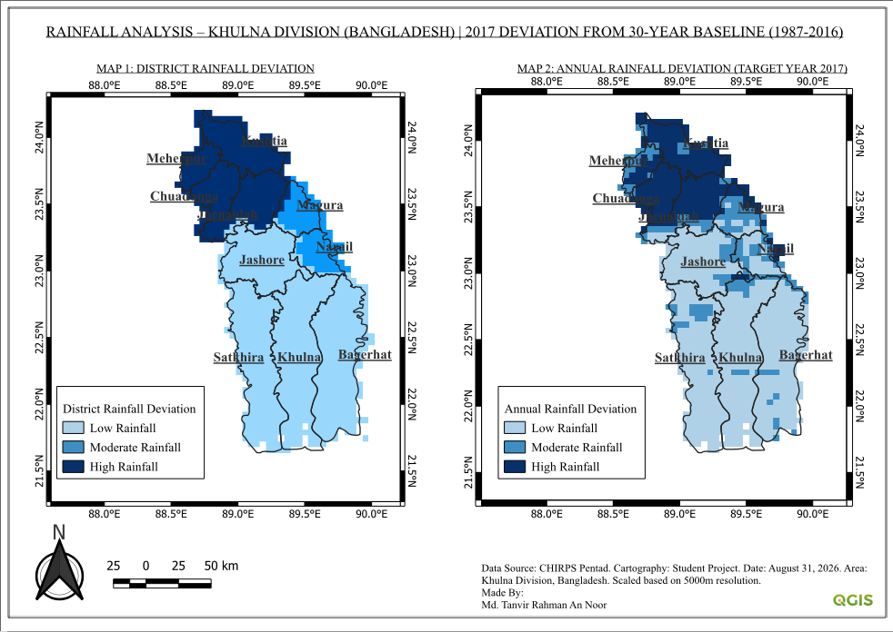

# Rainfall Deviation Analysis of Khulna Division, Bangladesh

* **Tools Used:** Google Earth Engine (JavaScript API), QGIS
* **Dataset:** CHIRPS Pentad/Daily Precipitation Data (1987–2017)
* **Methodology:** Analyzed 2017 regional rainfall anomalies against a 30-year historical baseline (1987–2016) using raster processing, zonal statistics, and thematic cartography.

### Map Output

